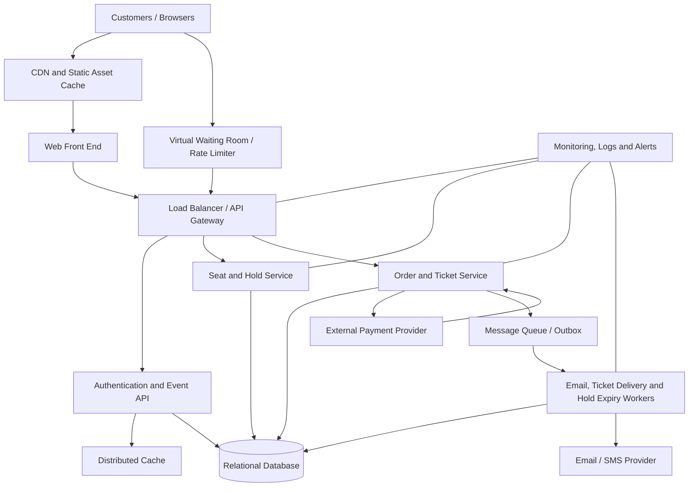

# TicketHub: Event Ticketing System Design

## 1. Requirements

### Functional requirements
- Users can register, sign in, and manage their profiles.
- Users can browse, search, filter, and view event details, dates, venues, prices, and availability.
- Users can view a venue's seat map and see whether each seat is available, held, or sold.
- An authenticated user can temporarily hold available seats before paying. A hold expires automatically after a short period (for example, five minutes).
- Users can pay for a valid order and receive confirmation and electronic tickets.
- Users can view their orders and tickets, and authorized staff can create events, configure seating and prices, and monitor sales.
- The system sends payment and ticket confirmations and supports idempotent payment retries so a repeated request does not create duplicate charges or tickets.

### Non-functional requirements
- **Speed:** Event pages should normally load in under 2 seconds at the 95th percentile. Seat availability and hold requests should usually respond within 500 ms at the 95th percentile, excluding third-party payment processing.
- **Correctness:** A seat can belong to no more than one active hold or completed sale at a time. Orders, payments, and tickets must be consistent even when requests are retried or services fail.
- **Fairness:** Requests for a high-demand event should enter a rate-limited virtual waiting room and be admitted in a controlled, observable order. Users should not gain an advantage by repeatedly refreshing or sending excessive requests. Expired holds must release seats automatically.
- **Availability and resilience:** Browsing should remain available during a sale surge even if checkout is throttled. Failed components should recover without losing confirmed orders.
- **Security and privacy:** Use HTTPS, secure authentication, authorization checks, rate limits, encrypted sensitive data, and a payment provider that handles card details. Do not store raw card numbers or security codes.
- **Scalability and observability:** Stateless application services should scale horizontally. Logs, metrics, traces, queue depth, payment failures, and seat-hold conflicts should be monitored.

## 2. Traffic and capacity estimates

These are planning estimates, not measured production results. They assume the supplied user and sales figures and make request-rate assumptions explicit.

### Normal day
- Registered users: 2,000,000.
- Daily visitors: 50,000.
- Page views: 50,000 visitors × 10 pages = **500,000 page views/day**.
- Average page-view rate: 500,000 ÷ 86,400 seconds ≈ **5.8 page views/second**.
- If each page view generates about 4 backend requests (event data, availability, recommendations/assets metadata, and session-related calls), this is approximately **2 million API requests/day**, or **23 requests/second on average**.
- Ticket sales: **5,000/day**, averaging about 0.058 completed sales/second. Actual demand will be uneven, so the system needs headroom above the daily average.

### Popular-concert sale
- 200,000 people try to buy tickets in 10 minutes: 200,000 ÷ 600 seconds ≈ **333 attempted buyers/second** on average.
- 20,000 seats are available, so attempted buyers outnumber seats by **10 to 1**. At most 10% of those people can obtain one seat if each person buys one.
- A burst can be much higher than the 333-per-second average. If each admitted buyer makes 3–5 checkout/seat requests, the checkout path may face roughly **1,000–1,700 requests/second on average**, with sharper short-lived spikes. Seat-map refreshes can multiply read traffic further.
- The waiting room limits how many users reach checkout at once. Cacheable event information is served from a CDN/cache, while seat holds and payments are handled by authoritative services with strict concurrency controls.

### Comparison and capacity strategy
The big-sale attempt rate is about 57 times the normal average page-view rate (333 versus 5.8 per second), although these are different request types and should not be treated as identical workloads. Compared with the estimated normal API average of 23 requests/second, 333 attempted buyers/second is about 14.5 times higher before counting extra requests per buyer. Design for horizontal scaling, load testing, back-pressure, and a queue rather than allowing every visitor to hit the database simultaneously.

## 3. API design

All endpoints use HTTPS and JSON. Authenticated endpoints require a session or bearer token. Responses include clear error codes, and state-changing requests use idempotency keys where noted.

| Method and endpoint | Purpose | Important behavior |
|---|---|---|
| `GET /api/events?query=&date=&page=` | Browse/search events | Cache public event details; paginate results. |
| `GET /api/events/{eventId}` | View event details | Returns venue, time, prices, and sale status. |
| `GET /api/events/{eventId}/seats` | View seat map and availability | Returns seat IDs and status; availability is advisory until a hold succeeds. |
| `POST /api/seat-holds` | Hold seats | Body includes `eventId`, `seatIds`; requires authentication and an idempotency key. Atomically holds all requested seats or none; returns expiry time or a conflict. |
| `DELETE /api/seat-holds/{holdId}` | Release a hold | Only the owning user can release it; already expired/released holds are handled safely. |
| `POST /api/orders` | Create an order from a valid hold | Verifies ownership, hold expiry, seat count, and price on the server. |
| `POST /api/orders/{orderId}/payment` | Pay for an order | Uses an idempotency key and payment-provider token; confirms tickets only after verified payment success. |
| `GET /api/me/orders` | View the user's orders | Returns order status, totals, and dates. |
| `GET /api/me/tickets` | View purchased tickets | Returns ticket IDs and validation codes for confirmed orders only. |

Typical error responses include `401 Unauthorized`, `403 Forbidden`, `404 Not Found`, `409 Conflict` for a seat that is no longer available, `410 Gone` for an expired hold, and `429 Too Many Requests` when rate-limited.

## 4. Data model

A relational database such as PostgreSQL is the source of truth for seat ownership, holds, orders, and payments. The following core tables show the main relationships.

### `users`
- `id` (PK)
- `email` (unique, not null)
- `password_hash` (not null)
- `created_at`

### `events`
- `id` (PK)
- `title`, `venue_name`, `starts_at`
- `status` (draft, scheduled, on_sale, sold_out, cancelled)
- `created_at`

### `seats`
- `id` (PK)
- `event_id` (FK → `events.id`)
- `section`, `row_label`, `seat_number`
- `price_cents`
- `status` (available, held, sold)
- `hold_id` (nullable FK → `seat_holds.id`, depending on implementation)
- Unique constraint on (`event_id`, `section`, `row_label`, `seat_number`)

A seat is defined per event, so the same physical venue seat can have a separate row for each event.

### `seat_holds`
- `id` (PK)
- `user_id` (FK → `users.id`)
- `event_id` (FK → `events.id`)
- `status` (active, expired, released, converted)
- `expires_at`
- `idempotency_key`
- `created_at`
- Unique constraint on (`user_id`, `idempotency_key`)

### `seat_hold_items`
- `hold_id` (FK → `seat_holds.id`)
- `seat_id` (FK → `seats.id`)
- Composite PK (`hold_id`, `seat_id`)
- Unique constraint on `seat_id` for active ownership if implemented with a separate active-claim table or an equivalent database-enforced claim mechanism.

### `orders`
- `id` (PK)
- `user_id` (FK → `users.id`)
- `hold_id` (FK → `seat_holds.id`, unique)
- `status` (pending_payment, paid, failed, cancelled, expired)
- `total_cents`, `currency`
- `created_at`, `paid_at`

### `order_items`
- `id` (PK)
- `order_id` (FK → `orders.id`)
- `seat_id` (FK → `seats.id`)
- `unit_price_cents`
- Unique constraint on `seat_id` so a seat cannot appear in two completed order items.

### `payments`
- `id` (PK)
- `order_id` (FK → `orders.id`)
- `provider_reference` (unique)
- `idempotency_key` (unique)
- `status` (pending, succeeded, failed, refunded)
- `amount_cents`, `created_at`

### `tickets`
- `id` (PK)
- `order_item_id` (FK → `order_items.id`, unique)
- `ticket_code` (unique)
- `issued_at`, `status` (valid, cancelled, used)

**Relationships:** One user can create many holds and orders. One event has many seats. One hold contains many seat-hold items. One order contains many order items and can have payment attempts, each tracked with a unique provider reference/idempotency key. Each successfully purchased order item produces one ticket.

Implementation note: database constraints must enforce the invariant, not just application checks. For example, use a dedicated `seat_claims` table with `seat_id` as its primary key and `status`, `owner_id`, and `expires_at` fields. In a transaction, insert or atomically replace only an expired claim; the primary key guarantees that two concurrent transactions cannot claim the same seat. The simplified `seats.status` fields above are useful for display, but the claim constraint is the final protection.

## 5. Preventing double-booking

A seat-map response is only a snapshot; two users may see the same seat as available at nearly the same time. Therefore, the server must make the hold operation atomic and must never rely on a client-side availability check.

1. Begin a database transaction for the requested seats.
2. Lock the relevant seat/claim rows in a consistent order (`SELECT ... FOR UPDATE`) to reduce deadlocks.
3. Check that every requested seat is available or has an expired claim. Create claims with a unique `seat_id` constraint, or update existing claims only when they are expired. The database uniqueness constraint makes simultaneous claims serialize: one transaction succeeds and the other receives a conflict.
4. If any requested seat cannot be claimed, roll back the whole transaction so the user does not receive only part of the requested group. Otherwise create the hold and hold items, set the expiry time, and commit.
5. Payment is performed outside the database transaction because an external payment call may take seconds. The order remains pending while payment is processed. A verified payment success is recorded idempotently, then a short transaction changes the order to paid, marks the claims/seats sold, and creates tickets. If payment fails or the hold expires, release the claims safely and reconcile any late payment result.
6. A background worker expires old holds, but every hold attempt also checks `expires_at` in the database so correctness does not depend on the worker running on time.

For checkout, enforce unique constraints on the seat claim and purchased `order_items.seat_id`, use idempotency keys for hold/order/payment requests, and process payment-provider webhooks idempotently. If the payment provider succeeds but the response is lost, a retry must retrieve the same payment result rather than charge again. This combination of transactions, row locks, unique constraints, expiry checks, and idempotency prevents double-booking under concurrency.

## 6. Architecture

### Component responsibilities
- **Web front end:** Displays event details, seat maps, checkout, and tickets. It treats seat availability as provisional until the server confirms a hold.
- **CDN and cache:** Serves static assets and cacheable public event information close to users, reducing origin traffic. Seat-claim writes are never trusted to a stale cache.
- **Virtual waiting room and rate limiter:** Queues high-demand traffic and admits a controlled number of users. It applies per-user/session limits and protects checkout and the database from overload.
- **Load balancer/API gateway:** Routes requests across stateless service instances, validates tokens, applies quotas, and rejects malformed or abusive traffic.
- **Authentication and event API:** Handles user identity, event search, and event details. Read-heavy results can be cached.
- **Seat and hold service:** Owns seat claims and atomic hold transactions. It is the only service allowed to create or release active claims.
- **Order and ticket service:** Calculates prices on the server, creates orders, coordinates payment state, and issues tickets only after confirmed payment.
- **Relational database:** Stores authoritative users, events, seats, claims, orders, payments, and tickets. Transactions and constraints protect correctness.
- **Payment provider:** Processes card payments so TicketHub does not store raw card data. Signed webhooks and idempotency keys handle delayed or repeated callbacks.
- **Message queue/outbox and workers:** Deliver confirmations, expire holds, and retry non-critical work without blocking checkout. An outbox written in the same transaction as an order-state change prevents lost messages.
- **Monitoring and alerting:** Tracks latency, error rates, queue wait, database contention, hold conflicts, payment outcomes, and capacity.

### How it survives the big sale
The waiting room absorbs the initial 200,000-person surge and releases users at a rate the checkout and database can sustain. The CDN and cache handle event-page reads; stateless APIs scale horizontally; queues buffer ticket delivery and other background work. The database remains the authority for seat claims and uses short transactions and uniqueness constraints rather than allowing caches to decide who owns a seat. Rate limits and back-pressure protect core checkout, while monitoring lets operators slow admission or pause a sale safely if error rates rise.

## 7. Trade-offs

1. **Strict consistency versus throughput:** Keeping seat claims and completed sales in a relational database with transactions and unique constraints adds lock contention during a popular sale, but it is worth the cost because selling one seat twice is unacceptable. Cache eventual consistency is acceptable for public event descriptions, not for final seat ownership.
2. **Waiting room versus instant access:** A waiting room adds friction and users may wait even when seats remain, but it protects the service and makes admission fairer than letting the fastest refreshers overwhelm checkout. Queue position and admission rules should be transparent and resistant to automation.
3. **Short holds versus customer convenience:** Five-minute holds reduce abandoned carts blocking seats, but may not give every buyer enough time to complete payment. The system should show a countdown, provide clear expiry messaging, and avoid extending holds indefinitely.
4. **Relational database versus distributed data store:** A relational database makes transactions, foreign keys, and uniqueness constraints straightforward. It may become a bottleneck at extreme scale, but splitting seat ownership across services/databases would increase complexity and make global correctness harder. Scale reads and stateless services first, then partition seat claims carefully if measured load requires it.

## 8. Assumptions and open questions
- Estimates assume one seat per attempted buyer for the big-sale calculation; group purchases would change the seat-to-buyer ratio.
- The 4 backend requests per page and 3–5 checkout requests per admitted buyer are explicit planning assumptions and should be validated with load tests.
- Before implementation, confirm whether users may hold multiple seats, the permitted ticket limit per user, payment-provider behavior for late success callbacks, refund/cancellation rules, and venue-specific seating constraints.
